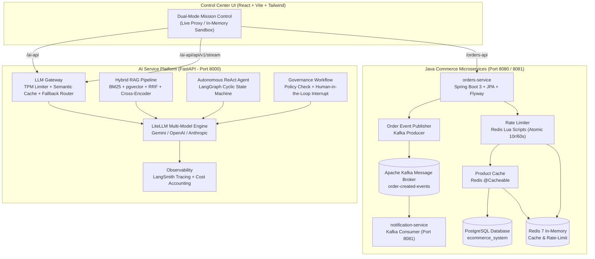

# Enterprise Polyglot Commerce & AI Control Center

> A production-grade distributed microservices monorepo combining **Java / Spring Boot 3** (transactional e-commerce, Redis caching, Kafka event streaming) and a **Python FastAPI GenAI Platform** (LiteLLM gateway, LangGraph agents, 4-stage Hybrid RAG, Human-in-the-Loop governance), all orchestrated from a unified **React + Vite Mission Control UI**.
>
> 🌐 **Polyglot Ecosystem Repositories**:
> - ☕ **Commerce Core & Control Center**: [`ecommerce-microservices-backend`](https://github.com/hk2257853/ecommerce-microservices-backend) *(this repository)*
> - 🤖 **Standalone AI Platform**: [`genai-service-platform`](https://github.com/hk2257853/genai-service-platform) *(FastAPI + LangGraph + LiteLLM)*

---

## ⚡ Architecture at a Glance

```text
┌──────────────────────────────────────────────────────────────────────────────────────────────────┐
│                             Control Center UI (React 18 + Vite + Tailwind)                       │
│                        [Live Proxy Mode]   •   [Simulated In-Memory Sandbox]                     │
└────────────────────────────────────┬──────────────────────────────────┬──────────────────────────┘
                                     │ /orders-api                      │ /ai-api
                                     │                                  │
         ┌───────────────────────────┴──────────┐   ┌───────────────────┴──────────────────────────┐
         │       Java Commerce Microservices    │   │         FastAPI AI Service Platform          │
         │                                      │   │                                              │
         │  ┌────────────────────────────────┐  │   │  ┌────────────────────────────────────────┐  │
         │  │ orders-service (Spring Boot 3) │  │   │  │   LLM Gateway (TPM + Semantic Cache)   │  │
         │  └───────────────┬────────────────┘  │   │  └───────────────────┬────────────────────┘  │
         │                  │                   │   │                      │                       │
         │                  ▼                   │   │                      ▼                       │
         │  ┌────────────────────────────────┐  │   │  ┌────────────────────────────────────────┐  │
         │  │ Redis Lua Rate Limiter (10r/m) │  │   │  │  Hybrid RAG (BM25 + Dense + Rerank)    │  │
         │  └───────────────┬────────────────┘  │   │  └───────────────────┬────────────────────┘  │
         │                  │                   │   │                      │                       │
         │                  ▼                   │   │                      ▼                       │
         │  ┌────────────────────────────────┐  │   │  ┌────────────────────────────────────────┐  │
         │  │   Redis 7 Product Cache        │  │   │  │ LangGraph Cyclic Agent & HITL Approval │  │
         │  └───────────────┬────────────────┘  │   │  └───────────────────┬────────────────────┘  │
         │                  │                   │   │                      │                       │
         │         ┌────────┴────────┐          │   │                      ▼                       │
         │         ▼                 ▼          │   │  ┌────────────────────────────────────────┐  │
         │  ┌─────────────┐   ┌──────────────┐  │   │  │  LiteLLM Router & LangSmith Tracing    │  │
         │  │ PostgreSQL  │   │ Apache Kafka │  │   │  └────────────────────────────────────────┘  │
         │  │ DB (Flyway) │   │ (Events Pub) │  │   │                                              │
         │  └─────────────┘   └──────┬───────┘  │   └──────────────────────────────────────────────┘
         │                           │          │
         │                           ▼          │
         │             ┌──────────────────────┐ │
         │             │ notification-service │ │
         │             │  (Kafka Consumer)    │ │
         │             └──────────────────────┘ │
         └──────────────────────────────────────┘
```

<details>
<summary>📊 <b>View Interactive Mermaid Flowchart</b></summary>



</details>

---

## 🎯 What's Inside & Why It's Built This Way

### 1. Java / Spring Boot Microservices (`orders-service` & `notification-service`)
- **Atomic Concurrency & Idempotency**: Strict idempotency key checking (`SETNX` pattern), Flyway database version migrations, and optimistic locking on inventory.
- **Fail-Open Rate Limiting**: Redis Lua script-powered sliding/fixed window rate limiter filter that attaches `X-RateLimit-*` headers to every response and fails open if Redis is temporarily unreachable.
- **Event-Driven Decoupling**: Kafka publisher emits `OrderCreatedEvent` payloads asynchronously so payment and notification downstream consumers never block transactional checkout threads.

### 2. Python GenAI Service Platform (`AiProject`)
- **Production RAG with 4-Stage Fusion**: Dense semantic vector embeddings + Sparse BM25 keyword search, merged via Reciprocal Rank Fusion (RRF) and re-ranked with a Cross-Encoder neural model. Also includes a LlamaIndex metadata-filtering pipeline.
- **Cyclic LangGraph Agent**: ReAct state-machine agent with loop guards, dynamic tool calling (discount calculations, order tracking, service health), and multi-turn short-term memory checkpoints.
- **Human-in-the-Loop (HITL) Governance**: LangGraph interrupt/resume workflow with deterministic policy evaluation. High-risk actions (e.g. refunding over threshold) pause execution and await RBAC-authorized human reviewer approval (`manager`, `admin`, `support_agent`).
- **Resilience & Cost Gateway**:
  - **Semantic Caching**: In-memory cosine-similarity vector cache to eliminate redundant LLM calls and reduce latency by ~90%.
  - **Token-Per-Minute (TPM) Sliding Budget**: Prevents upstream provider quota exhaustion.
  - **Circuit Breakers**: LiteLLM fallback router with automatic model cooldowns and failover routing.
  - **Financial Observability**: Real-time USD cost tracking and LangSmith tracing.

### 3. Mission Control UI (`control-center-ui`)
- **Calm Studio Design System**: Clean light-first interface with soft dark mode toggle, zero neon eye-strain, and generous typography.
- **Dual-Mode Operation**:
  - **`live`**: Proxies requests directly to the live Spring Boot and FastAPI backend instances, with real-time SSE streaming for token-by-token generation and live TTFT (Time-to-First-Token) display.
  - **`sim`**: Standalone in-memory simulator that replicates rate limits, idempotency checks, Kafka feeds, RAG scoring, and LangGraph HITL approval flows without needing running infrastructure.

---

## 🧭 Design Decisions & Roadmap

### 💡 Conscious Trade-offs
- **Decoupled Agent Tools vs. Live Spring Boot Client**:
  To allow rapid prototyping and ensure the AI platform remained 100% testable in isolation, the LangGraph agent tools currently query rich domain fixtures (`mock_ecommerce.py`).
- **Next Milestone**:
  Wire the Python Agent tools directly to the live Java Spring Boot REST API (`http://localhost:8080/api/orders/{id}`) with graceful fallback to cached fixtures if the Java service is offline.

---

## 🚀 3-Step Quickstart

### Prerequisites
- Java 17+ & Node.js 18+
- Python 3.10+
- (Optional for full live persistence) Docker / PostgreSQL / Redis / Kafka

### Step 1: Start the Java Backend
```powershell
cd orders-service
# Optional: start Redis & Kafka via docker-compose
docker compose up -d
# Run Spring Boot service
cd ..
.\gradlew.bat :orders-service:bootRun
```
*API Swagger Docs: [http://localhost:8080/swagger-ui.html](http://localhost:8080/swagger-ui.html)*

### Step 2: Start the AI Service Platform
```powershell
cd AiProject
py -m pip install -r requirements.txt
# Copy template and add your Gemini / OpenAI API key
copy .env.template .env
py -m uvicorn ai_service_platform.main:app --port 8000 --reload
```
*API Swagger Docs: [http://127.0.0.1:8000/docs](http://127.0.0.1:8000/docs)*

### Step 3: Launch the Control Center UI
```powershell
cd control-center-ui
npm install
npm run dev
```
*Open in your browser: [http://localhost:5173/](http://localhost:5173/)*

---

## 📁 Repository Layout

```text
├── orders-service/         # Spring Boot 3 Commerce Service (Port 8080)
├── notification-service/   # Kafka Consumer Microservice (Port 8081)
├── common/                 # Shared Java DTOs (OrderCreatedEvent)
├── control-center-ui/      # React + Vite + Tailwind Mission Control (Port 5173)
├── AiProject/              # Standalone AI Platform (github.com/hk2257853/genai-service-platform)
└── docker-compose.yml      # Local dev infra (Postgres, Redis, Kafka, Kafka-UI)
```

---

## 📄 License
MIT

